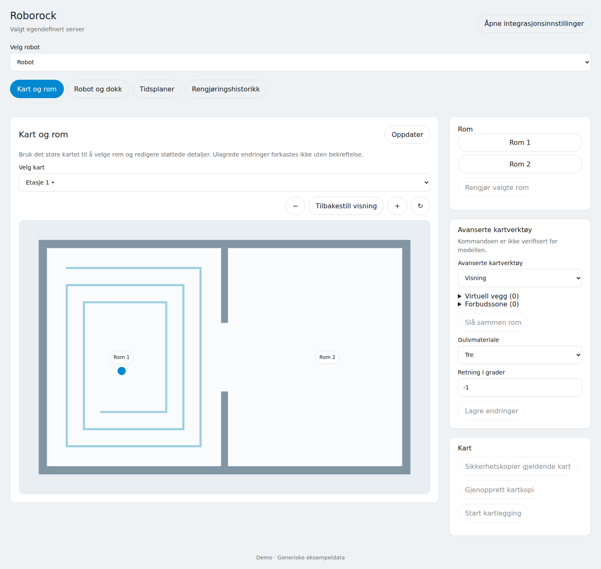

<p align="center"></p>

# Roborock Companion

Advanced Roborock configuration, map tools and controls through Home Assistant's
**official Roborock integration**. The integration adds a desktop/tablet sidebar
panel and a narrow bridge to the existing HA connection. It does not create a
second robot client, duplicate vacuum entities or store copied login credentials.

Pairs with [Lovelace Roborock](https://github.com/mvheimburg/lovelace-roborock)
0.1.0+ / API v1. Standard card controls work without this companion. Both packages
are independent HACS repositories. The upstream
[local_roborock_server](https://github.com/Python-roborock/local_roborock_server)
is a separate service, deployable in an existing Docker stack; no LocalRock
mobile-app fork is required.

## Installation

1. Use HA Core **2026.11.1+** with the official Roborock integration configured.
2. In HACS, add `https://github.com/mvheimburg/roborock-companion` in the
   **Integration** category, install and restart HA. Before the initial release
   is published, manual installation copies `custom_components/roborock_companion`
   into HA's `config/custom_components/` directory.
3. Go to **Settings → Devices & services → Add integration → Roborock Companion**.
   Select an existing Roborock vacuum. No new account/password is requested.
4. Open **Roborock** in the sidebar, or use **Configure** on this integration.
   The admin panel works without a custom card. Choose a robot and floor, then
   edit a draft and explicitly Save; Cancel leaves saved data untouched.

For the owner's **HA OS in Proxmox + separate Docker support stack + Saros 20
Sonic 02.58.82** deployment, follow the
[complete Norwegian setup and traffic guide](docs/roborock-local-setup.nb.md)
and [Docker stack example](deploy/roborock/README.nb.md).
The official HA integration's **Manual** region points to the local server;
installing that server does not automatically repoint an existing HA entry.

## Configuration and device support

The large panel keeps map work separate from the everyday card. It offers
entity-backed robot/dock settings, HA room display names, floor/map views,
coordinate input and supported map tools. It preserves user-defined names and
never renames existing HA entity IDs. Room display names are local aliases in
this companion, not a claim that the robot/cloud room registry was renamed.
The integration creates no additional measurement entities. Binding follows the
entity registry identity through ordinary renames and persists the device identity;
reassigning that entity to another device fails closed. Re-add the companion to
choose a replacement robot.

Unconfirmed requests keep writes disabled until an explicit read-only Refresh.
Cancel discards a draft without clearing operation uncertainty. Other successful
operations preserve unrelated drafts; partial settings saves retain the fields
that still differ from HA.

| Function | Current behavior |
| --- | --- |
| Existing robot/dock settings | Structured controls use the official integration's switch/select/number/time entities and button actions. Enable relevant disabled entities in HA first. |
| Room selection and map view | Existing parser data, real image calibration, authenticated image endpoint, zoom and coordinate tools. |
| Room split/merge and floor material | Disabled in this initial release: no exact model/firmware command profile has been verified. Feature bits alone never enable physical map writes. |
| Walls and no-go zones | Disabled until an exact command profile is verified. The preservation audit additionally rejects duplicate blocks, unknown layouts, flags, truncation and unmodeled restrictions. |
| Map backup/restore and mapping | Disabled until model/firmware command evidence is verified. No experimental bypass is exposed. |
| Go-to point and zone cleaning | Public HA actions through the companion, checked against a map revision; available only for a single saved map with calibrated geometry. Dispatch is not reported as physical completion. |
| Cleaning-session history | Bounded on-demand reads through the existing connection; independent of recorder charts. |
| Schedules | The panel opens HA's standard automation editor. The upstream server documents incomplete native timer support; native schedule CRUD is not advertised. No browser scheduler is used. |
| Carpets, thresholds, map deletion/rename, SmartPlan, per-room cleaning order and manual driving | Not enabled until protocol/readback/model support is verified. These are limitations, not completed parity claims. |
| Camera, firmware updates and phone provisioning | Outside this package. Follow upstream model-specific documentation if needed. |

The Saros 20 Sonic 02.58.82 report confirms upstream local-server compatibility,
not all advanced writes in this component. No owner's robot was operated during
implementation. The shipped exact-protocol profile table is empty. These map-writing tools are
implementation groundwork, not usable Saros features yet. The adapter deliberately fails closed when the official HA
runtime, geometry or firmware capability cannot be identified safely.

## Local and cloud traffic

The companion follows the official integration's **configured backend**. With
standard cloud setup, that includes Roborock services; with a correctly configured
local server, MQTT and map requests target that server. A direct local socket
is a connection fact, not proof every command stayed local. Initial cloud import,
certificate renewal and software downloads are separate external flows.
Use firewall policy and real restart/map-update tests from the setup guide to
verify the deployment. Blocking robot WAN alone does not prove that HA or the
server sent nothing externally.

## Safety and permissions

Map/settings changes require HA administrator access and read permission for the
bound robot. The companion accepts only named, validated operations; no arbitrary
RPC console is exposed. Requests carry revisions and IDs, are bounded/serialized,
and are not replayed automatically after reconnect. Save does not start cleaning.
A multi-step failure reports completed steps and preserves the remaining draft;
there is no claim of transaction rollback on the physical robot.

Maps and credentials are private home data. Images require HA authentication and
entity permission. No map content or credentials are included in diagnostics.
English and Norwegian Bokmål, safe locale aliases and live language changes are
supported; HA and user-provided names remain recognizable.

## Development and verification

Use Python 3.14 and Node 24+:

```bash
python -m venv .venv
.venv/bin/pip install -r requirements_test.txt
.venv/bin/python -m pytest -q
.venv/bin/ruff check custom_components tests
npm ci --prefix frontend
npx --prefix frontend playwright install --with-deps chromium
npm test --prefix frontend
npm run lint --prefix frontend
npm run typecheck --prefix frontend
npm run build --prefix frontend
```

Commit rebuilt panel assets. CI also runs hassfest and HACS validation, and checks
project/manifest versions. The published custom-component test harness 0.13.375
pins HA **2026.10.4**; the real HA fixture tests use that version with
python-roborock **7.12.0**, while target **2026.11.1** APIs were inspected separately.
The harness's logger helpers are not compatible with 2026.11.x, so this distinction
is not hidden by monkey-patching test helpers. Hardware/live-HA verification on
2026.11.1 remains a separate step before relying on advanced writes.

Protocol and safeguards are informed by the MIT-licensed
[LocalRock](https://github.com/DonSidro/LocalRock) and
[python-roborock](https://github.com/Python-roborock/python-roborock) projects.
This project is independent of Roborock. See [API v1](docs/api-v1.md).

Repository description and topics are configured. Maintenance command:

```bash
gh repo edit mvheimburg/roborock-companion --description "Advanced Roborock configuration, map tools and controls through Home Assistant's official Roborock integration." --add-topic home-assistant --add-topic homeassistant --add-topic hacs --add-topic hacs-integration --add-topic roborock --add-topic robot-vacuum
```

## Preview


